  

  
  

## Sobre mí

Diseño arquitecturas en AWS y automatizo cómo se construyen, prueban y despliegan. Busco sistemas que se puedan reproducir, observar y escalar sin sorpresas.

- 🏗️ **Arquitectura de soluciones**: diseños según el AWS Well-Architected Framework: escalables, resilientes, seguros y con el coste bajo control.
- ⚙️ **DevOps**: infraestructura como código con Terraform, contenedores y Kubernetes, CI/CD con GitHub Actions y Jenkins y automatización con n8n.
- 🛡️ **Seguridad como base**: análisis de riesgos con PILAR, cumplimiento ISO/IEC 27001, gestión de secretos con Vault y verificación con OWASP ASVS.

## Certificaciones

<table>
  <tr>
    <td width="120" align="center">
      
    </td>
    <td>
      <strong>AWS Certified Solutions Architect – Associate</strong> 
      Amazon Web Services Training and Certification 
      Emitida: septiembre de 2026 · Válida hasta: septiembre de 2029  
      
    </td>
  </tr>
</table>

## Stack

| Área | Tecnologías |
| --- | --- |
| **Cloud y arquitectura** |     |
| **DevOps y automatización** |     |
| **Desarrollo** |        |
| **Seguridad** |       |

## Dashboard

  <picture>
    <source media="(prefers-color-scheme: dark)" srcset="https://raw.githubusercontent.com/Rubenpg4/Rubenpg4/output/stats-dark.svg">
    
  </picture>
  <picture>
    <source media="(prefers-color-scheme: dark)" srcset="https://raw.githubusercontent.com/Rubenpg4/Rubenpg4/output/languages-dark.svg">
    
  </picture>

## Proyectos destacados

  <a href="https://github.com/Rubenpg4/Cuaderno_bitacora">
    <picture>
      <source media="(prefers-color-scheme: dark)" srcset="https://raw.githubusercontent.com/Rubenpg4/Rubenpg4/output/project-cuaderno_bitacora-dark.svg">
      
    </picture>
  </a>
  <a href="https://github.com/Rubenpg4/SafeBiteApp">
    <picture>
      <source media="(prefers-color-scheme: dark)" srcset="https://raw.githubusercontent.com/Rubenpg4/Rubenpg4/output/project-safebiteapp-dark.svg">
      
    </picture>
  </a>
  <a href="https://github.com/Rubenpg4/TFG-IDS-basado-en-flujo-de-datos">
    <picture>
      <source media="(prefers-color-scheme: dark)" srcset="https://raw.githubusercontent.com/Rubenpg4/Rubenpg4/output/project-tfg-ids-basado-en-flujo-de-datos-dark.svg">
      
    </picture>
  </a>
  <a href="https://github.com/Rubenpg4/Wordle-Movil">
    <picture>
      <source media="(prefers-color-scheme: dark)" srcset="https://raw.githubusercontent.com/Rubenpg4/Rubenpg4/output/project-wordle-movil-dark.svg">
      
    </picture>
  </a>

## Contribuciones

  <picture>
    <source media="(prefers-color-scheme: dark)" srcset="https://raw.githubusercontent.com/Rubenpg4/Rubenpg4/output/snake-dark.svg">
    
  </picture>

  Este perfil se regenera cada día con <a href="https://github.com/Rubenpg4/Rubenpg4/actions/workflows/dashboard.yml">GitHub Actions</a>: tarjetas SVG propias generadas desde la API de GitHub y el snake de contribuciones.

